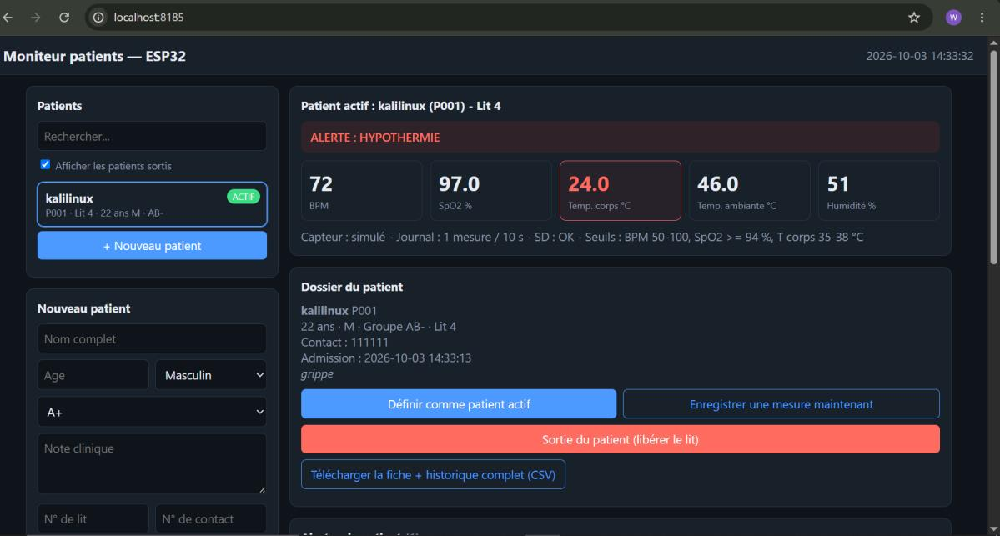
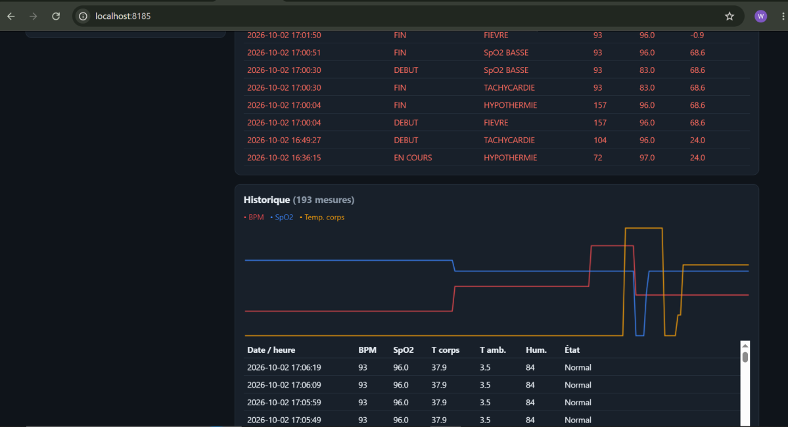
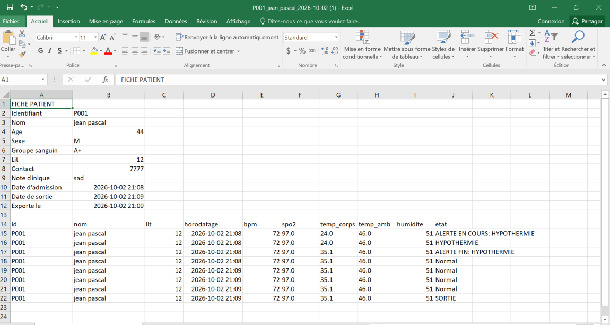

# Moniteur de santé multi-patients avec base de données embarquée

## Description

**Moniteur de santé multi-patients avec base de données embarquée** est un système de surveillance médicale expérimental basé sur un ESP32.

Le système permet de surveiller plusieurs patients à partir de différents capteurs physiologiques, d'afficher les mesures sur un écran OLED et de conserver les données dans une carte SD.

Une interface Web intégrée à l'ESP32 permet également de gérer les patients, consulter leur historique, visualiser les mesures en temps réel et consulter les alertes.

Le système peut fonctionner avec un MAX30102 réel ou passer automatiquement en mode simulation lorsque le capteur n'est pas détecté.

> **Avertissement :** ce projet est un prototype éducatif et expérimental. Il ne constitue pas un dispositif médical certifié et les mesures ne doivent pas être utilisées seules pour établir un diagnostic médical.

---

## Objectifs du projet

Les objectifs principaux sont :

- Développer un système de surveillance multi-patients avec ESP32.
- Mesurer la fréquence cardiaque.
- Mesurer la SpO₂.
- Mesurer la température corporelle.
- Mesurer la température ambiante.
- Mesurer l'humidité ambiante.
- Afficher les données sur un écran OLED.
- Détecter automatiquement certaines situations d'alerte.
- Enregistrer les mesures sur une carte SD.
- Conserver un historique individuel pour chaque patient.
- Gérer l'admission et la sortie des patients.
- Identifier chaque patient avec un identifiant unique.
- Permettre la gestion des patients depuis une interface Web.
- Permettre le téléchargement de l'historique au format CSV.
- Permettre la simulation des valeurs du MAX30102 lorsque le capteur réel est absent.
- Afficher une représentation graphique de l'évolution des mesures.

---

## Fonctionnalités

### Gestion des patients

L'interface Web permet de :

- Créer un nouveau patient.
- Générer automatiquement un identifiant patient.
- Enregistrer le nom du patient.
- Enregistrer son âge.
- Enregistrer son sexe.
- Enregistrer son groupe sanguin.
- Ajouter une note clinique.
- Associer un numéro de lit.
- Ajouter un numéro de contact.
- Enregistrer la date d'admission.
- Définir un patient comme patient actif.
- Enregistrer la sortie d'un patient.
- Libérer automatiquement son lit.
- Conserver son historique après sa sortie.

Chaque patient reçoit un identifiant de type :

```
P001
P002
P003
...
```

Le système empêche également l'utilisation simultanée d'un même lit par deux patients.

### Surveillance des paramètres

Le système surveille notamment :

| Paramètre | Capteur / source |
|---|---|
| Fréquence cardiaque | MAX30102 |
| SpO₂ | MAX30102 |
| Température corporelle | NTC |
| Température ambiante | DHT22 |
| Humidité | DHT22 |
| ECG graphique | Généré à partir de la fréquence cardiaque |

Le MAX30102 est utilisé pour obtenir les données de fréquence cardiaque et de SpO₂.

### Système d'alertes

Le système possède plusieurs seuils configurables :

- BPM minimum : 50
- BPM maximum : 100
- SpO₂ minimum : 94 %
- Température haute : 38 °C
- Température basse : 35 °C

Ces seuils sont définis directement dans le programme.

Les alertes possibles sont :

- Bradycardie
- Tachycardie
- SpO₂ basse
- Fièvre
- Hypothermie
- Absence de signal

Une valeur doit rester hors seuil pendant **2 secondes** avant que l'alerte soit confirmée.

### Stockage des données

Les données sont enregistrées sur une carte SD.

Le système utilise notamment les fichiers :

```
/patients.csv
/alerts.csv
/active.txt
/sorties.csv
/rec/P001.csv
/rec/P002.csv
/rec/P003.csv
...
```

Chaque patient possède donc son propre fichier historique.

Les mesures enregistrées comprennent notamment :

- Date / heure
- BPM
- SpO₂
- Température corporelle
- Température ambiante
- Humidité
- État

Le système conserve également les événements d'alerte.

### Écran OLED

Le système utilise un écran :

- OLED SSD1306
- 128 × 64 pixels
- I2C
- Adresse : `0x3C`

L'écran affiche notamment :

- BPM
- SpO₂
- Température corporelle
- Température ambiante
- Humidité
- État / alerte
- Identifiant du patient
- Nom du patient
- Numéro de lit
- Adresse IP

Le programme initialise actuellement l'écran avec l'adresse I2C `0x3C`.

---

## Connexions

### ESP32

La configuration actuelle du programme utilise :

| Fonction | GPIO |
|---|---|
| SDA I2C | GPIO 21 |
| SCL I2C | GPIO 22 |
| NTC | GPIO 35 |
| DHT22 | GPIO 15 |
| SD CS | GPIO 5 |
| SD SCK | GPIO 18 |
| SD MISO | GPIO 19 |
| SD MOSI | GPIO 23 |

Ces broches correspondent aux définitions présentes dans le programme.

---

## Liste des composants

### Composants principaux

- **ESP32** : microcontrôleur principal du système.
- **Écran OLED SSD1306 128×64** : affichage des différentes mesures.
- **Capteur MAX30102** : détection de la fréquence cardiaque et de la SpO₂.
- **Capteur DHT22** : détection de la température et de l'humidité ambiantes.
- **Thermistance NTC** : détection de la température du patient.
- **Module / carte SD** : stockage des données.
- **Fils Dupont** : connexion des composants.

### Composants optionnels

- Alimentation externe
- Boîtier
- Résistances adaptées au circuit NTC
- Autres capteurs compatibles

---

## Bibliothèques utilisées

Le programme utilise notamment :

```cpp
#include <Arduino.h>
#include <Wire.h>
#include <SPI.h>
#include <SD.h>
#include <WiFi.h>
#include <WebServer.h>
#include <time.h>
#include <Adafruit_GFX.h>
#include <Adafruit_SSD1306.h>
#include <DHT.h>
#include "MAX30105.h"
#include "heartRate.h"
```

---

## Installation

### Prérequis

- [Visual Studio Code](https://code.visualstudio.com/)
- Extension [PlatformIO IDE](https://platformio.org/install/ide?install=vscode)
- Extension [Wokwi Simulator](https://marketplace.visualstudio.com/items?itemName=wokwi.wokwi-vscode) (une licence gratuite doit être activée depuis VS Code : `F1` → *Wokwi: Request a New License*)

### Étapes

1. **Récupérer le projet**

   ```bash
   git clone https://github.com/Anonymous88810-ux/Hospital-project.git
   cd Hospital-project
   ```

2. **Ouvrir le dossier dans VS Code.** PlatformIO télécharge automatiquement la plateforme `espressif32` et les bibliothèques au premier chargement.

3. **Compiler le firmware** (icône ✔ de la barre PlatformIO, ou en terminal) :

   ```bash
   pio run
   ```

   Cela produit `.pio/build/esp32dev/firmware.bin` et `firmware.elf`, utilisés par `wokwi.toml`.

---

## Utilisation

### Lancer la simulation

1. Dans VS Code : `F1` → **Wokwi: Start Simulator**.
2. Dans le moniteur série (115200 bauds), attendre les messages :

   ```
   MAX30102 absent : mode simulation
   Carte SD OK
   IP : ...
   Serveur web demarre (port 80)
   ```

3. Ouvrir le tableau de bord : <http://localhost:8185> (le port 8185 de la machine est redirigé vers le port 80 de l'ESP32 par `wokwi.toml`).

Le Wi-Fi utilisé en simulation est le réseau `Wokwi-GUEST` (sans mot de passe).

### Synchronisation de l'heure

Le système utilise NTP pour récupérer automatiquement la date et l'heure.

La configuration actuelle utilise le fuseau horaire d'Haïti :

```cpp
#define TZ_INFO "EST5EDT,M3.2.0,M11.1.0"
```

L'heure est ensuite utilisée pour dater les mesures, les admissions, les sorties et les alertes.

---

## Interface Web

Après la connexion au Wi-Fi, l'ESP32 démarre un serveur Web sur le **port 80**.

L'interface permet notamment de :

- Voir les patients.
- Ajouter un patient.
- Sélectionner un patient actif.
- Voir les mesures en temps réel.
- Voir les alertes.
- Voir l'historique.
- Visualiser les données sous forme graphique.
- Enregistrer une mesure manuellement.
- Enregistrer la sortie d'un patient.
- Télécharger la fiche et l'historique au format CSV.



---

## Mode simulation

Le projet possède un mode simulation intégré.

Lorsque le MAX30102 n'est pas détecté, le système utilise automatiquement des valeurs simulées.

Les valeurs peuvent être modifiées depuis l'interface Web :

- BPM
- SpO₂
- Présence du doigt

Cela permet de tester le système d'alertes sans avoir obligatoirement le capteur physique connecté.

Le mode simulation est explicitement prévu dans le programme lorsque le MAX30102 est absent.

---

## Historique

Chaque patient possède son historique.

Exemple : `P001.csv`

Une ligne peut contenir :

- Date / heure
- BPM
- SpO₂
- Température corporelle
- Température ambiante
- Humidité
- État

L'interface Web peut afficher les mesures sous forme de tableau et de graphique.



L'historique complet peut également être téléchargé au format CSV.



---

## Sortie d'un patient

Lorsqu'un patient quitte le système :

1. Sa dernière mesure peut être enregistrée.
2. Les alertes en cours sont clôturées.
3. Le patient est marqué comme sorti.
4. Son lit est libéré.
5. Son historique est conservé.
6. La date et l'heure de sortie sont enregistrées.

Le système permet donc de conserver l'historique même après la sortie du patient.

---

## Fonctionnement général

```
                 ┌─────────────────┐
                 │      ESP32      │
                 └────────┬────────┘
                          │
          ┌───────────────┼────────────────┐
          │               │                │
          ▼               ▼                ▼
      MAX30102          DHT22              NTC
     BPM / SpO₂   Temp / Humidité      Température
          │               │                │
          └───────────────┼────────────────┘
                          │
                          ▼
                  ┌──────────────┐
                  │  Traitement  │
                  │ des données  │
                  └──────┬───────┘
                         │
             ┌───────────┼───────────┐
             ▼           ▼           ▼
           OLED       Carte SD      Wi-Fi
             │           │           │
             ▼           ▼           ▼
        Affichage    Historique   Interface Web
                     Patients
                     Alertes
```

### Logique des alertes

```
Mesure
  │
  ▼
Vérification des seuils
  │
  ├── Normal ───────────────► État normal
  │
  └── Valeur anormale
         │
         ▼
   Attente 2 secondes
         │
         ▼
   Alerte confirmée
         │
         ▼
   Enregistrement sur SD
```

---

## Sécurité et confidentialité

Le projet traite des informations pouvant être considérées comme sensibles, notamment les données liées aux patients.

Pour une utilisation réelle, le système devrait intégrer des mécanismes supplémentaires tels que :

- Authentification.
- Autorisation des utilisateurs.
- Chiffrement des données.
- Protection de l'interface Web.
- Sécurisation du réseau Wi-Fi.
- Contrôle des accès aux données.
- Protection de la carte SD.
- Journalisation sécurisée.

Le prototype actuel ne doit donc pas être considéré comme un système médical sécurisé prêt pour une utilisation clinique.

---

## Limites du prototype

Ce projet est un prototype électronique.

Les mesures des capteurs peuvent être influencées par :

- La qualité des capteurs.
- Le positionnement du capteur.
- Les mouvements du patient.
- Les conditions environnementales.
- La qualité de l'alimentation électrique.
- Le câblage.
- Les algorithmes utilisés pour calculer les valeurs.

Les valeurs doivent donc être considérées comme des données expérimentales.

---

## Auteurs

- Thayana Alabré
- Médgine Prudent
- Worldweede Romain
- Achille Eden Linerson
- Sasquia Obelus Charles

Projet développé autour de :

- IoT
- ESP32 (Wi-Fi)
- Électronique
- Programmation embarquée
- Surveillance des paramètres physiologiques
- Bases de données embarquées
- Développement Web
- Stockage sur carte SD

---

## Contribution

Les contributions, corrections et améliorations sont les bienvenues.

Pour commencer :

```bash
git clone https://github.com/Anonymous88810-ux/Hospital-project.git
```

Créer une branche :

```bash
git checkout -b nouvelle-fonctionnalite
```

Après les modifications :

```bash
git add .
git commit -m "Ajout d'une nouvelle fonctionnalité"
git push origin nouvelle-fonctionnalite
```

Une Pull Request peut ensuite être créée sur GitHub.
